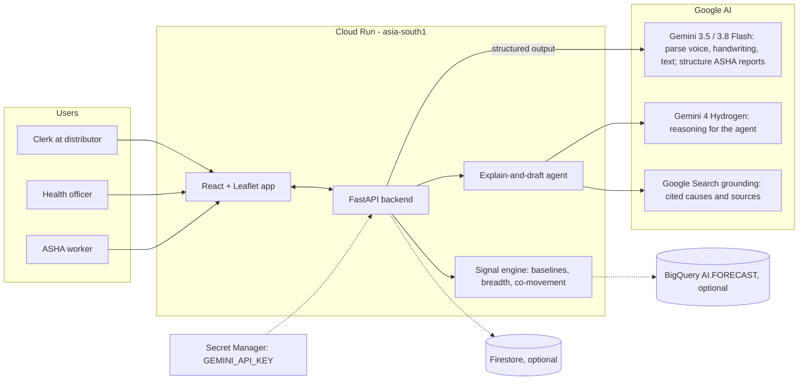

# FirstSign

## Submission links

| What | Link |
|---|---|
| Live product | https://firstsign-735269146498.asia-south1.run.app (also https://firstsign-jbzxxect5q-el.a.run.app) |
| Demo video (2:16, plays in the browser) | https://firstsign-735269146498.asia-south1.run.app/demo.mp4 |
| Demo video (file in this repo) | [docs/video/FirstSign_demo.mp4](docs/video/FirstSign_demo.mp4) · captions: [FirstSign_demo_captions.srt](docs/video/FirstSign_demo_captions.srt) |
| Pitch deck (PDF) | [docs/FirstSign_Pitch_Deck.pdf](docs/FirstSign_Pitch_Deck.pdf) |
| Submission deck (organisers' template) | [docs/submission/FirstSign_Final_Submission.pptx](docs/submission/FirstSign_Final_Submission.pptx) · [PDF](docs/submission/FirstSign_Final_Submission.pdf) |

**Sign in:** the live product opens on a demo sign-in. Every account uses the password `firstsign`:

| Account | Opens |
|---|---|
| clerk@saikrupa.demo | Distributor order inbox |
| owner@saikrupa.demo | Stock radar |
| officer@wardhealth.demo | Health officer map and alerts |
| sunita@asha.demo | ASHA phone view (Hindi first) |
| chemist@unitymedical.demo | Chemist: send an order |
| founder@firstsign.demo | Every workspace, with a switcher |

The sign-in is a demo gate for the jury, not real authentication.


FirstSign is an AI order desk for Indian medicine distributors. Chemists send orders on WhatsApp as voice notes or photos of handwritten lists. FirstSign reads them (Hindi, Marathi, English and Hinglish) and turns them into ready-to-bill orders that a clerk checks and approves.

Because every order passes through, FirstSign also sees which medicine groups are rising in each pin code compared with normal. It shows that as:

1. **Stock radar (distributor):** "stock up on these, and here is why".
2. **Health officer view:** a ranked list of where ASHA workers should visit next, built from a live signal instead of past case data.
3. **ASHA view:** the ASHA records her visit observations as a voice note in her own language. Gemini structures it. One report moves the alert's confidence; **two independent reports confirm it**; a near-zero report lowers it. Each becomes labelled ground truth.

A Gemini agent explains why an area is rising (using Google Search grounding) and drafts the actions. **A human approves every outbound action**, the screen always shows what the AI is unsure of, nothing is silently corrected, and every approval is written to an audit log.

Built for the Google DeepMind x Google Cloud Startup Buildathon India 2026.

> **Simulated data.** All order history, chemists, ASHA workers, voice notes and handwritten chits in this repository are simulated for the demo and are labelled so in the UI. No real patient or personal data is used anywhere.

## Architecture



| Google service | What it does here |
|---|---|
| Gemini 3.5 Flash (fallback: 3.8 Flash, 3.1 Flash-Lite) | Reads voice notes and handwriting, matches to the catalogue, and structures ASHA reports. Always uses a JSON response schema. |
| Gemini 4 Hydrogen (fallback: 3.5 Flash) | Reasoning step of the agent: why is this area rising, and what should each person do. |
| Google Search grounding | Gives the agent cited, external evidence. Sources are shown to the officer. |
| Cloud Run (asia-south1) | Hosts the app and API on one port, min 1 instance for the demo. |
| Secret Manager | Holds `GEMINI_API_KEY`; never baked into the image. |
| Cloud Build and Artifact Registry | Build and store the container image. |
| Firestore (optional) | `STORAGE=firestore` persists orders, audit and alerts. Default is local. |
| BigQuery (optional) | `SIGNAL_BACKEND=bigquery` exports counts and uses `AI.FORECAST` for baselines. Written as a design and not yet run against BigQuery; default is local. |

Every model call has a fallback chain on 429/503, exponential backoff, a disk cache keyed by input hash, and an offline mode so the demo never dies. When a result comes from the pre-recorded fallback, the UI labels it `offline-sample`.

**Gemini engineering.** Each call is metered (tokens by type, latency, cache hit, fallback, INR cost) in a usage ledger, served at `GET /api/ai/usage` and shown on the About page. The order prompt puts the catalogue first so Gemini's implicit cache applies (about 68% of prompt tokens measured at the cached rate); thinking is `minimal` for parsing and `medium` for the agent; a concurrency cap, a per-IP rate limit, jittered retries and a daily spend guard (`DAILY_GEMINI_BUDGET_INR`, default 300) protect quota and money. Measured cost is about INR 0.25 per order read. See [docs/GEMINI_ENGINEERING.md](docs/GEMINI_ENGINEERING.md); reproduce with `python -m app.measure --orders --asha --explain 2` (spends real money).

## Run locally

Requirements: Python 3.11, Node 20+ (Node 24 tested). Put your key in `.env` (copy `.env.example`):

```
GEMINI_API_KEY=your-key
```

One command:

```powershell
.\run_local.ps1        # Windows
```
```bash
bash run_local.sh      # macOS, Linux, Git Bash
```

This builds the frontend if needed and serves the app and API on <http://localhost:8000>. With no key, or with `DEMO_OFFLINE=1`, it uses canned results from `data/samples/*.expected.json`.

Tests:

```bash
cd backend && python -m pytest        # 132 tests, offline (frontend: 41 with npm test)
cd frontend && npm test && npm run lint
```

Before a demo, fill the Gemini cache so repeated steps answer instantly even when the model is slow or rate-limited: `cd backend && python -m app.warm`.

## Extended simulated data and new endpoints

`data/extended/` holds 90 days of simulated raw records (14,331 orders, stock, claims, ASHA reports, official counts, lab positivity) and one **real** file, Open-Meteo weather and air quality. The backend exposes it through `/api/overview`, `/api/backtest`, `/api/environment`, `/api/stockouts` and `/api/asha/history`, sharpens the stock radar with days of cover and last week's unmet requests, and lets a chemist send an order with `POST /api/chemist/send` so it lands in the distributor inbox. The back-test is a replay of a **simulated** scenario, not evidence; every response says so. If `data/extended` is missing the endpoints still answer, empty, with a note. Shapes are in `ARCHITECTURE.md` section 5.

## Deploy to Google Cloud Run

Needs the Google Cloud SDK, `gcloud auth login`, and billing enabled on project `firstsign-buildathon`.

```bash
bash infra/deploy.sh
```

The script enables the APIs, creates the Artifact Registry repo, stores the key from `.env` in Secret Manager (never echoed), builds with Cloud Build using `infra/Dockerfile`, deploys to Cloud Run in `asia-south1` (unauthenticated, 1 GiB, min 1 instance), and prints and checks the URL.

Local container:

```bash
docker build -f infra/Dockerfile -t firstsign .
docker run --rm -p 8080:8080 --env-file .env firstsign
```

## Data and privacy rules

- No patient names are stored. Orders hold chemist ID, pin code, items and time only.
- ASHA reports store counts, not names.
- Audio and images are processed in memory and not kept beyond the request (demo samples excepted). Media a chemist sends through the app (`POST /api/chemist/send`) is kept in `backend/.state/media` so the clerk can replay it.
- The API key lives only in `.env` (git-ignored) locally and in Secret Manager in the cloud.
- Every approval and every line edit is recorded in the audit log.

## Repo map

| Path | What is there |
|---|---|
| `ARCHITECTURE.md` | The build contract: layout, API, data files, rules |
| `backend/` | FastAPI app (`app/`) and tests; earlier run logs are in `docs/archive/` |
| `frontend/` | Vite, React, TypeScript, Tailwind app; builds to `frontend/dist` |
| `data/` | Simulated seed data, samples (voice, photos) and generators |
| `docs/` | Product, metrics, design, demo script, deck, contract requests |
| `infra/` | `Dockerfile`, `deploy.sh`, `cloudbuild.yaml` |
| `run_local.ps1`, `run_local.sh` | One-command local run on port 8000 |
